 

### ✦ Express lane → my about-me site ✦

---

## ✦ Arsenal — tech I channel

&nbsp;&nbsp;
&nbsp;&nbsp;
&nbsp;&nbsp;
&nbsp;&nbsp;
&nbsp;&nbsp;
&nbsp;&nbsp;
&nbsp;&nbsp;
&nbsp;&nbsp;

---

## ✦ Works

- **[DialogueSystem](https://github.com/ArmaLv/DialogueSystem)** — a dialogue system for 2D Unity games. Branching lines, portraits, and the logic behind a conversation.
- **[StyTab](https://github.com/ArmaLv/StyTab)** — a minimalist browser startpage that stays out of your way.

> 🕯️ *More small worlds are taking shape in the dark — they'll surface on [itch.io](https://armalatv.itch.io/) and [ArtStation](https://www.artstation.com/armalatv).*

---

## ✦ Currently

- **Learning:** Unity & its components · Blender · Pixel Composer · musical art · visual art
- **Building:** game systems and small tools
- **Cooking:** solo-dev projects, one verse at a time

---

## ✦ Find me in the drift

 

---

## ✦ Symphony of Mercy — support

If a little of my light reaches you, you can keep the hymn going with a coffee 🕯️

 

✦ thanks for drifting by ✦

