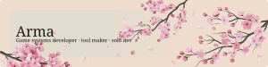

**Game systems developer · tool maker · solo dev**

---

## About

I build gameplay systems and small, focused tools — mostly in Unity with C#, with the occasional web utility on the side. I care about clean, reusable components and software that stays out of the user's way. When I'm not writing code, I'm working on pixel and visual art.

- **Focus:** Unity game systems, developer tools, UI
- **Currently learning:** Unity internals · Blender · Pixel Composer · visual & musical art
- **Open to:** collaboration on game and tooling projects

---

## Tech Stack

&nbsp;&nbsp;
&nbsp;&nbsp;
&nbsp;&nbsp;
&nbsp;&nbsp;
&nbsp;&nbsp;
&nbsp;&nbsp;
&nbsp;&nbsp;
&nbsp;&nbsp;
&nbsp;&nbsp;

---

## Project Showcase

**Highlights**

- **[FlexibleGridLayout](https://github.com/ArmaLv/FlexibleGridLayout)** — a smarter, more flexible grid layout component for Unity UI. *(C#)*
- **[DialogueSystem](https://github.com/ArmaLv/DialogueSystem)** — a dialogue system for 2D Unity games: branching lines, portraits, and conversation flow logic.
- **[Colors / Palette.exe](https://github.com/ArmaLv/Colors)** — a browser-based color toolkit for extracting palettes from images, swapping image colors, and managing reusable palettes. *(JavaScript)*
- **[SyncYomi-LibraryView](https://github.com/ArmaLv/SyncYomi-LibraryView)** — a tiny, single-file local web UI for a self-hosted SyncYomi server on Windows. *(Python)*

> More work-in-progress — games and tools — surfaces on [itch.io](https://armalatv.itch.io/) and [ArtStation](https://www.artstation.com/armalatv).

---

## GitHub Stats

 

---

## Support

If my work is useful to you, you can support it over a coffee.

 

Thanks for stopping by.

